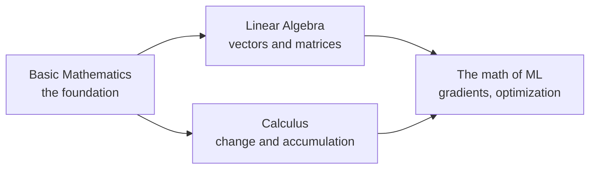

# Golang Mathematics

Learning the mathematics behind software and machine learning by working through Serge Lang's textbooks, and rewriting every idea in them as working, tested Go code.

The project follows three of Lang's books in order:

1. ***Basic Mathematics***: the foundation, covering numbers, algebra, geometry, trigonometry, functions, complex numbers, induction and determinants.
2. ***Linear Algebra***: vectors, matrices, linear maps and eigenvalues.
3. ***Calculus***: limits, derivatives, integrals and series.

Each chapter becomes a Go package. Definitions become types, rules become functions, and worked examples become programs you can run. By the end, the repo is a small numerical library I built and tested myself, one chapter at a time.

---

## Why this project

I'm learning Go for backend systems and for deploying machine-learning models to production. That work rests on mathematics: vectors and matrices, gradients, summations, numerical precision. Rather than study math in one place and code in another, this project does both at once.

Writing code changes how math is learned:

- **Notation becomes concrete.** $\sum_{i=1}^{n} x_i$ is a `for` loop. A function $f: A \to B$ is a Go `func`. A matrix is a slice of slices.
- **Vague understanding gets exposed.** You can't write a function for a rule you only half understand.
- **Answers get checked.** Every result is tested, instead of trusted.

## The path



*Basic Mathematics* comes first because both later books assume it. Linear algebra and calculus can then run in either order, and together they cover most of the mathematics used to train and run machine-learning models.

---

## Stage 1: *Basic Mathematics*

| Part | Ch | Topic | What it becomes in Go | Status |
|---|---|---|---|---|
| **I. Algebra** | 1 | Numbers | Integers, rationals, the rules of arithmetic, divisibility | ⬜ |
| | 2 | Linear equations | Solving systems in two and three unknowns | ⬜ |
| | 3 | Real numbers | Exact arithmetic with `math/big`, roots, rationalizing, inequalities | ✅ |
| | 4 | Quadratic equations | Discriminant, completing the square, a numerically stable quadratic solver | 🚧 |
| | — | Interlude: logic | Statements, implications, proofs, mathematical expressions | ⬜ |
| **II. Intuitive geometry** | 5 | Distance and angles | Distances, angle measure, the Pythagorean theorem | ⬜ |
| | 6 | Isometries | Reflections, rotations and translations as functions on points | ⬜ |
| | 7 | Area and applications | Areas of shapes, circles, $\pi$ | ⬜ |
| **III. Coordinate geometry** | 8 | Coordinates and geometry | Points as `struct`s, distance formula | ⬜ |
| | 9 | Operations on points | Adding and scaling points, the start of vectors | ⬜ |
| | 10 | Segments, rays and lines | Parametric lines, intersections | ⬜ |
| | 11 | Trigonometry | Radians, sine and cosine, identities | ⬜ |
| | 12 | Some analytic geometry | Circles, parabolas, ellipses, hyperbolas | ⬜ |
| **IV. Miscellaneous** | 13 | Functions | Functions as values, composition, inverses | ⬜ |
| | 14 | Mappings | Mappings between sets, linear maps | ⬜ |
| | 15 | Complex numbers | `complex128`, polar form, multiplication as rotation | ⬜ |
| | 16 | Induction and summations | $\sum$ notation, closed-form sums, proof by induction | ⬜ |
| | 17 | Determinants | Determinants, Cramer's rule, solving linear systems | ⬜ |

## Stage 2: *Linear Algebra*

Builds directly on Chapters 9, 14 and 17 of *Basic Mathematics*.

| Topic | What it becomes in Go | Why it matters | Status |
|---|---|---|---|
| Vectors | A `Vector` type: addition, scaling, norms, distance | every input to a model is a vector | ⬜ |
| Dot product and angles | `Dot`, cosine similarity, projections | comparing embeddings, semantic search | ⬜ |
| Matrices | A `Matrix` type, multiplication, transpose | a neural-network layer is a matrix multiply | ⬜ |
| Systems of linear equations | Gaussian elimination, row reduction | solving for unknowns, least squares | ⬜ |
| Vector spaces and bases | span, independence, dimension | understanding what a model's features can represent | ⬜ |
| Linear maps | functions as matrices, composition as multiplication | how layers transform data | ⬜ |
| Determinants and inverses | general determinants, invertibility | when a system has a unique solution | ⬜ |
| Eigenvalues and eigenvectors | power iteration | PCA, dimensionality reduction | ⬜ |

## Stage 3: *Calculus*

Builds on Chapters 3, 11, 13 and 16 of *Basic Mathematics*.

| Topic | What it becomes in Go | Why it matters | Status |
|---|---|---|---|
| Limits | numerically approaching a value, and where floats break down | the foundation of derivatives | ⬜ |
| Derivatives | numerical differentiation, comparing against exact rules | the slope that training follows | ⬜ |
| Rules of differentiation, chain rule | a small automatic-differentiation engine | the chain rule *is* backpropagation | ⬜ |
| Applications: maxima and minima | Newton's method, gradient descent | how models are optimized | ⬜ |
| Exponentials and logarithms | $e^x$ and $\ln x$ from series, stable `log-sum-exp` | softmax, cross-entropy loss | ⬜ |
| Integration | Riemann sums, trapezoid and Simpson's rules | areas, probabilities, expected values | ⬜ |
| Taylor series | approximating functions with polynomials | how libraries compute `sin`, `exp`, `log` | ⬜ |

✅ done · 🚧 in progress · ⬜ not started

---

## How each chapter is built

Every chapter, in every book, follows the same four steps:

1. **Read** the chapter and work the key examples by hand.
2. **Model** the ideas in Go: definitions become types, rules become functions.
3. **Demonstrate** with a small program that works through the chapter's examples and prints the reasoning step by step.
4. **Verify** with tests: plug answers back in, check rules on many inputs, and compare exact results against decimal approximations.

For example, in *Basic Mathematics* Chapter 3, rationalizing a denominator

$$\frac{1}{a + b\sqrt{n}} = \frac{a - b\sqrt{n}}{a^2 - b^2 n}$$

becomes a `Surd` type that stores $a + b\sqrt{n}$ as exact fractions, plus `Conjugate`, `Mul` and `Rationalize` functions. The program prints the moment the square root cancels to $0$, and checks that the final answer has the same value as the original fraction.

The same method carries into the later books. In *Calculus*, a derivative rule gets checked against a numerical derivative. In *Linear Algebra*, a solved system gets checked by multiplying the matrix by the solution.

## How the books connect in code

Later packages reuse earlier ones instead of starting over:

- *Basic Mathematics* Ch 9 (operations on points) grows into the `Vector` type in *Linear Algebra*.
- *Basic Mathematics* Ch 17 (determinants) is generalized from $2 \times 2$ and $3 \times 3$ to any size.
- *Basic Mathematics* Ch 16 (summations) supplies the $\sum$ code used for integrals and series in *Calculus*.
- *Linear Algebra* and *Calculus* meet at the gradient, the vector of partial derivatives that gradient descent follows.

## Principles

- **Exact first, decimals second.** Computers can't store numbers like $\sqrt{2}$, or even $0.1$, exactly. Where it matters, results are computed exactly with `math/big`, and `float64` is used only to check them.
- **Verify, don't trust.** Every answer is checked, either against the original equation or against an independent calculation.
- **Respect what the math forbids.** Division by zero, square roots of negatives, singular matrices and other degenerate cases return errors instead of crashing or producing `NaN`.
- **Follow the book's definitions.** If Lang defines division as multiplying by an inverse, the code does it that way too, so the code reads like the math.
- **Notice where math and computers disagree.** When floating point breaks a rule that holds for real numbers (for example, $(a + b) + c \neq a + (b + c)$), or when a formula that's correct on paper loses accuracy in code, that gets documented, not hidden.
- **Build from scratch, then compare.** Everything is written by hand first. Libraries such as [`gonum`](https://www.gonum.org/) come in later only to check the results.

## Running the code

You need Go 1.25 or newer.

```bash
git clone https://github.com/felix-the-cache/golang-mathematics.git
cd golang-mathematics
```

Each chapter lives in its own folder. To run a chapter's demonstration:

```bash
cd RealNumbers
go run .
```

To run a chapter's tests, once it has them:

```bash
go test ./...
```

## Resources

- Serge Lang, *Basic Mathematics*
- Serge Lang, *Linear Algebra*
- Serge Lang, *Calculus*
- [A Tour of Go](https://go.dev/tour/)
- [`math/big` package documentation](https://pkg.go.dev/math/big), for exact arithmetic
- [`math` package documentation](https://pkg.go.dev/math)
- [3Blue1Brown](https://www.3blue1brown.com/), *Essence of Linear Algebra* and *Essence of Calculus*, for visual intuition alongside the books
